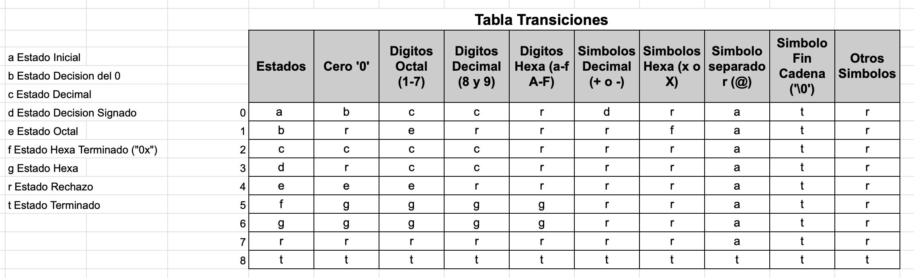
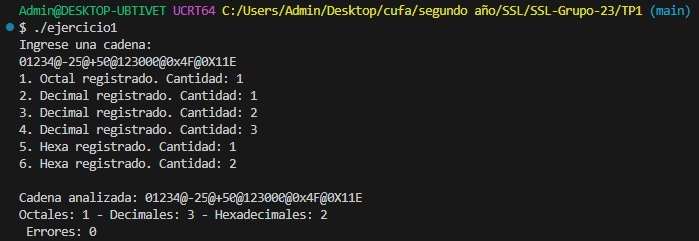
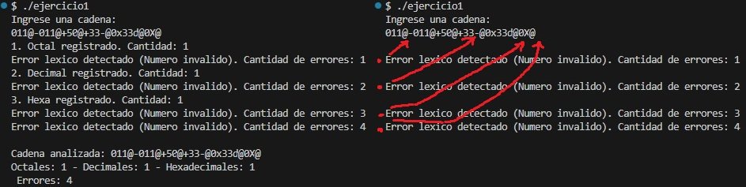
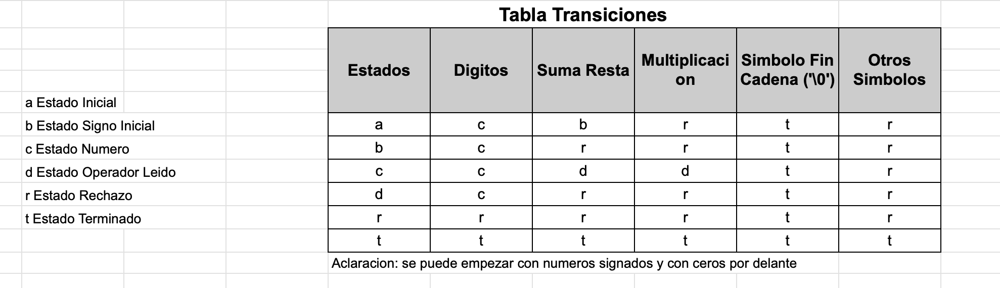
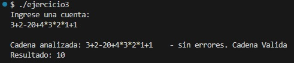
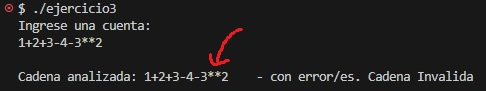

# TRABAJO PRÁCTICO 1
## CARATULA
### Titulo: TP Automatas (1)
### Integrantes: Marcos Ortiz Olivero, Tomas Jack Yedid, Fausto Mazzeo
### Materia: Sintaxis y Semántica de los Lenguajes
### Comision: K2002
### Año: 2026
### Fecha de entrega: 26-9-2026

## DESCRIPCION
Este trabajo práctico cuenta con 3 ejercicios, donde había que implementar el conocimiento adquirido referido a autómatas.

A rasgos generales, el punto número uno constaba en diseñar un identificador de números octales, decimales y hexadecimales, reconociendo los números válidos y rechazando las "palabras" inválidas. El segundo punto simplemente constaba en desarrollar una función que a partir de un caracter numérico devuelva su valor en formato entero (int). Por último, en el tercer punto se pedía diseñar una estructura capaz de detectar y resolver una cuenta aritmética con sumas, restas y multiplicaciones, obteniendo su resultado. A continuación, se detalla un poco más a fondo lo desarrollado en cada instancia y la lógica utilizada, desde nuestro punto de vista.

   *Nota: De todas formas, el código generalmente suele estar comentado con alguna explicación de lo que se está haciendo*

## PUNTO 1

En este ejercicio se desarrolló un **autómata** con 9 estados:

- Estado Inicial (0),
- Estado Decisión del Cero (1),
- Estado Decimal (2),
- Estado Decisión Signado (3),
- Estado Octal (4),
- Estado Hexa Recién Terminado (5), o Hexa Terminado
- Estado Hexa (6),
- Estado de Rechazo (7),
- Estado Terminado (8)

La resolución está pensada para que, cuando el usuario ingrese los distintos números separados por el carácter '@', se entre en un bucle while propio del autómata, que finaliza cuando se alcanza el Estado Terminado. Dentro de la lógica del autómata, se obtiene un carácter de la cadena y se calcula a qué columna de la tabla corresponde (determinado por una función auxiliar), para con esto último determinar el próximo estado al que se transiciona (determinado por la matriz bidimensional que representa la tabla). Posteriormente, se verifica si hubo error con la ayuda de una función auxiliar, teniendo en cuenta los siguientes aspectos:

1- El estado próximo es el Estado de Rechazo
2- Se llegó al Estado Inicial (es decir, se leyó un '@' y se pasó al próximo número) o Estado Terminado partiendo del Estado Decisión del Cero (Registró "0", está incompleto)
3- Se llegó al Estado Inicial o Estado Terminado partiendo del Estado Decisión Signado (Registró "-" o "+", está incompleto)
4- Se llegó al Estado Inicial o Estado Terminado partiendo del Estado Hexa Terminado (Registró "0x" o "0X", está incompleto)
5- Se llegó al Estado Inicial partiendo de ese mismo estado (Registró doble '@', input inválido)
6- Se llegó al Estado Terminado partiendo del Estado Inicial (Registró un '@' y luego fin de cadena '\0', input inválido)

Todos estos casos son considerados errores y convierten al "número" ingresado como una "palabra" rechazada, por lo que cambian el flag de huboError a verdadero.

Después, se avanza con el momento de registro, donde si no hubo error y se registran estados de "corte" (se volvió al Estado inicial porque se avanzó con el siguiente número ingresado o simplemente termino la cadena y se llegó a Estado Terminado), se contabiliza el número válido recién registrado de acuerdo a su tipo (Octal, Decimal, Hexa). En caso contrario, se contabiliza el error y se imprime en pantalla un aviso.

Por último, aparece la parte de la lógica propia del bucle, donde primero se reinicia el flag de huboError (si el carácter que se registro es el separador de números '@') para después cambiar el estado actual por el estado siguiente y aumentar el offset/índice que recorre la cadena.

*Aclaraciones*:
- La solución es un autómata que recorre la cadena y reconoce los tipos numéricos solicitados
- La detección de números es un poco "estricta", el input del usuario debe ser el correcto (de lo contrario es considerado error, como se detalla en el listado con lo referido a los estados intermedios y a la utilización del símbolo separador). El número cero (0) considerado que no pertenece a ninguna de las tres clasificaciones, el "0x" o "0X" sin ningun otro numero, los numeros con ceros iniciales repetidos, son todas cadenas consideradas inválidas y vistas como errores.

## PUNTO 2

Este ejercicio consta simplemente del desarrollo de una función *funcion2*, la cual recibe un parámetro tipo char y devuelve un int.
Dicha función tiene la peculiaridad de aprovechar que C trabaja los caracteres como números enteros a partir de su valor decimal según ASCII, y opera con ello. Define una variable entera, igualándola al carácter ingresado como parámetro, y considerando que los números del 0 al 9 están contiguos en la tabla ASCII, logra calcular el valor entero del dígito ingresado simplemente restando '0' a la variable en cuestión (C entiende al caracter como su ASCII equivalente y resta ese numero) y retornando el resultado.

## PUNTO 3

Este ejercicio es un poco más extenso y consta de dos partes. En primer lugar se encuentra la lógica del reconocimiento de la cadena ingresada, donde se toma lo ya desarrollado y pensado en el punto 1 (en cuanto a autómata/algoritmo), pero adaptado a las condiciones de lo que se exige en esta instancia. Por otra parte, pasado el reconocimiento y validación de la cadena, comienza la segunda parte, destinada al cálculo y resolución aritmética de lo que fue ingresado. A continuación se detalla por separado lo desarrollado en ambas 

### Primera Parte (Autómata)
Como se mencionó anteriormente, se adaptó la lógica del autómata del punto 1, contando con una versión simplificada de 6 **estados**:
- Estado Inicial (0),
- Estado Signo Inicial (1),
- Estado Número (2),
- Estado Operador Leído (3),
- Estado de Rechazo (4),
- Estado Terminado (5)

La lógica es muy similar: un bucle que opera siempre y cuando no haya habido error y no se haya llegado al Estado Terminado. Se obtiene un cáracter de la cadena, se lo clasifica en una columna, se obtiene el próximo estado de la transición, se verifica que no haya habido errores (estos son más simples, ocurren cuando se cae en el Estado de Rechazo tras consumir un caracter o cuando se llega al Estado Terminado sin provenir del Estado Número). Posteriormente, se aumenta el offset en 1 y el estado que antes era el estado siguiente ahora es el estado actual.

### Segunda parte (Cálculo)
En este segundo bloque se introducen cosas nuevas y un poco más de lógica, ya que es necesario lidiar con cuestiones como la precedencia y el orden aritmético de las operaciones. Para esto fue necesario la implementación y la incorporación de una ***pila*** propia desarrollada. Por medio de esta fue posible llegar a una solución amigable, ampliando los detalles de la misma en las siguiente líneas:

En primer lugar, hay que introducir la idea de "término", que refiere a un número, su operación asociada y la prioridad de dicha operación (ejemplo: "30+" es un "término" en "30+20"). Reconociendo estos términos, apilándolos y resolviendo las operaciones asociadas entre sus números según el nivel de prioridad es cómo se puede llegar al resultado.

Primero se declaran las variables y flag necesarios, como el terminoActual y obtuveResultado, para luego operar en bucle (siempre y cuando obtuveResultado sea falso). Mediante funciones auxiliares, se obtienen de cada término:
	1- el número, los cuales necesitan de un algoritmo de lectura, con sus propias funciones auxiliares, para pasar de chars a enteros, respetando las unidades y su signo (este algoritmo además utiliza la función del punto 2 *funcion2*). Se representa con un entero
	2- la operación asociada, se representa con un entero
	3- la prioridad de la operación: multiplicación > suma y resta > vacío (cuando el número es el "último número" de la cuenta). La prioridad es descendiente, representada con entero, siendo los valores más bajos los más importantes. 

En cada iteración del bucle while principal, se lee la cadena y se obtienen estos 3 datos del término, luego se procede a hacer el manejo de la pila en otro bucle while:
El último término apilado se opera con el término recién leído (usando la operación del término apilado), siempre que el primero mencionado sea de igual o mayor prioridad, y el resultado se guarda en el número del término actual. Si esto no se cumple, se continúa en el bucle principal apilando el término actual. De esta manera, cuando aparecen operaciones más prioritarias, las de menor prioridad quedan apiladas, dejando paso a la resolución por prioridad. Cuando se llega al último término (el cual tiene menor prioridad), el bucle termina de resolver todas las operaciones y todos los términos apilados llegando al resultado, y se cambia el flag obtuveResultado.

Algunas funciones auxiliares conllevan cierta complejidad:
- Para obtener el número del término, la función primero corrobora si es el primer término de la cadena y si este comienza con un signo (importante para modificar el offset y para el valor final del número). Luego, recorre la cadena hasta leer una operación, de manera que ya posiciona el offset en el próximo término y también calcula la cantidad de cifras del número. Con esto, se empieza a "reconstruir" el número, volviendo a recorrerlo por completo y sumando unidad por unidad, recurriendo a la función del ejercicio 2 y a otra función auxiliar para las potencias de 10. Por último, si el término empezaba con un signo '-', se multiplica por -1 al valor del número.

## ANEXO

### Compilacion

Se puede utilizar `gcc Ejercicio1.c -o ejercicio1` para el punto 1, y `gcc Ejercicio3.c Ejercicio2.c -o ejercicio3` para el punto 3 (el cual requiere tambien del codigo del punto 2)

### Ejercicio1

***DEFINICION AUTOMATA***

- Q = {a, b, c, d, e, f, g, r}
	- a: Inicial
	- b: Decisión del 0
	- c: Decimal
	- d: Decisión Signado
	- e: Octal
	- f: Hexa Terminado ("0x")
	- g: Hexa
	- r: Rechazo
- Σ = {0–9, a–f, A–F, x, X, +, −}
- q₀ = a
- F = {c, e, g}
- δ: Q × Σ → Q (ver tabla de transiciones)

***TABLA TRANSICIONES***

***PRUEBAS***

### Ejercicio3

***DEFINICION AUTOMATA***

- Q = {a, b, c, d, r}
	- a: Inicial
	- b: Signo Inicial
	- c: Número
	- d: Operador Leído
	- r: Rechazo
- Σ = {0, 1, 2, 3, 4, 5, 6, 7, 8, 9, +, −, *}
- q₀ = a
- F = {c}
- δ: Q × Σ → Q

***TABLA TRANSICIONES***

***PRUEBAS***

